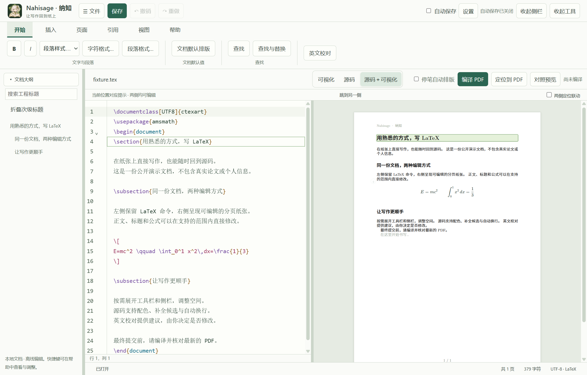

# Nahisage · 纳知

**像 Word 一样直接编辑论文，同时保留 LaTeX 源码。**

Nahisage 是一款本地 LaTeX 论文编辑器。你可以在分页纸张上直接修改支持的正文、公式和表格，也可以随时切换到源码，继续使用熟悉的 LaTeX 命令。

喜欢直观写作，就在纸张上改；需要精细控制，就打开源码。两种方式围绕同一份文档工作，文件仍以 `.tex` 形式保存。

**Windows x64 公开测试版 v0.2.10 已开放下载（Pre-release）。**

[下载 Windows x64 安装包](https://github.com/Henrystation/Nahisage/releases/download/v0.2.10/Nahisage-Setup-0.2.10-x64.exe) · [版本说明、已知限制与 SHA-256 校验文件](https://github.com/Henrystation/Nahisage/releases/tag/v0.2.10)

这是公开测试版，建议先使用论文副本体验。安装包未签名。无需提前安装 TeX：软件内提供环境检查和两步安装指引，已有可用环境也可直接接入。请下载 `.exe` 安装包；GitHub 自动生成的 Source code 压缩包仅包含本公开介绍仓库的内容。

## 实机界面展示

左侧是 LaTeX 源码，右侧是可直接编辑的分页纸张；在支持的内容范围内，两侧修改会同步到同一份文档。

## 写论文时，它能帮你做什么？

### 在纸张上直接写，也能左右对照源码

编辑区采用分页纸张视图，正文、标题和公式呈现在页面内部。支持源码与可视化模式切换，也支持左侧源码、右侧可编辑页面的双栏显示。

在支持的内容范围内，两侧修改会同步到文档；位置联动帮助你找到对应段落或字段。你可以先直观修改文字，再回到源码处理细节。

### 常见修改不用每次都手写命令

通过顶部工具栏完成常用编辑操作，包括选区字体和字号、段落设置，以及支持的公式、图片和基础表格编辑。需要直接调整命令时，也可以打开局部源码。

### 继续保留写 LaTeX 的习惯

源码编辑提供语法高亮、配色设置和代码补全候选；补全由你选择后插入。支持浅色、深色主题，并提供快捷键帮助和常用快捷键设置。

### 用真实 LaTeX 编译结果检查最终排版

配合本机 TeX 环境，可以编译文档、查看最终 PDF，并导出 PDF 或项目压缩包。编辑后的页面反馈与 LaTeX 编译是两个过程：最终交稿请以最新编译生成的 PDF 为准。

### 给日常写作多一层保存保障

支持手动保存、可自行开启的自动保存，以及恢复草稿的查看、恢复和删除。自动保存开关由你控制；重要论文仍建议保留独立备份。

### 从论文示例开始

提供 IEEEtran、Elsevier 等英文论文示例，以及按不同写作场景整理的自编示例，方便创建文档和了解结构。期刊要求可能变化，投稿前请核对期刊提供的最新模板；自编示例不代表学校或期刊官方认证。

## 下载与使用

1. 从上方下载入口获取 Windows x64 安装包并安装。
2. 在「帮助 → TeX 环境检查」中确认编译环境。没有环境时，按界面提供的两步命令下载并安装 TeX；已有可用的 TeX Live 或 MiKTeX 可直接接入。安装包不包含完整 TeX 发行版，首次配置需要联网；编译具体文档仍需相应的宏包和字体。
3. 新建示例文档，或先打开自己论文的一份副本，体验可视化编辑与源码切换。
4. 完成修改后保存，检查最新编译的 PDF，再导出交稿文件。

两步安装引导已在另一台 Windows 电脑上完成 TeX 配置，并验证英文、中文、BibTeX 和 Biber 文档的编译与 PDF 导出。该次测试使用管理员账户；全新普通账户及其他系统配置仍待进一步验证。

## 当前支持范围

Nahisage 目前处于公开测试阶段，可视化编辑主要覆盖已支持的常见文档结构。复杂宏、自定义环境、跨页复杂表格，以及部分双栏版式，可能仍需要通过源码修改和最终 PDF 检查。

编辑区的分页与真实 LaTeX 编译结果可能存在差异，目前不承诺任意模板都能完整可视化，或编辑页面与最终 PDF 完全一致。

如果你已经有顺手的 LaTeX 工具，可以先用一篇文档副本试试 Nahisage，看看它是否适合你的修改习惯。

## 常见问题

**这是开源项目吗？**

目前应用源码保持私有。本仓库用于公开介绍、安装包下载、版本记录和问题反馈。软件的使用范围以随包提供的许可说明为准；使用的第三方组件按各自许可证标注。

**文件还能在其他 LaTeX 工具里继续用吗？**

文档以标准 `.tex` 文件及相关项目资源保存，可以继续使用其他 LaTeX 编辑器和编译工具；编译时仍需相应的图片、参考文献文件、宏包和字体。

**必须赞助才能使用吗？**

不需要。当前公开测试版免费提供，赞助完全自愿，不影响本测试版的功能使用。愿意支持开发，可以查看下方的[自愿支持说明](#关于作者与自愿支持)。

## 反馈问题

欢迎通过本仓库的 Issues 提交问题或建议。描述时尽量提供：

- 软件版本、Windows 版本，以及使用的 TeX 发行版。
- 具体操作步骤、预期结果和实际结果。
- 能复现问题的最小 `.tex` 示例，或必要的截图、编译错误信息。

提交示例前，请删除未公开的研究内容、姓名、学号和其他个人信息。无需上传整篇论文。

## 后续开发计划
- 形似 mlx 或 jupiter notebook 的分区块编辑
- 界面交互逻辑的整体优化
- 公式编辑器的代码自动联想和自动补全
- 表格编辑器的相关功能完善

## 关于作者与自愿支持

由 **Henrystation** 开发和维护。这个项目来自我自己写论文时的需求，开发过程中使用了 AI 辅助工具，也会继续根据实际使用反馈修复和完善。

如果它帮你节省了时间，欢迎分享给需要的人，或者反馈一次真实使用体验。如果你愿意赞助，可以通过下方支付宝收款码，自愿支持软件的维护和测试。

  

使用支付宝扫一扫，或保存图片后在支付宝中识别。金额自定，量力而行。

赞助不购买功能排期、专属服务或固定更新承诺。感谢每一位试用、反馈和支持的人。

## 贡献与致谢

感谢 [@KhanZou](https://github.com/KhanZou) 师兄向我展示 Typora 打开和编辑 Markdown 文件的直观界面，为 Nahisage 的可视化 LaTeX 编辑体验提供了最初的灵感。
